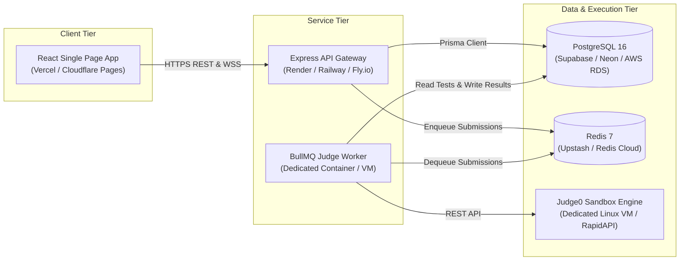

# CampusOJ Production Deployment Guide

This guide outlines recommended strategies and deployment configurations for deploying CampusOJ in a production cloud environment.

---

## 1. Production Topology Overview



---

## 2. Managed Cloud Services Setup

### A. Database (PostgreSQL 16)
- **Providers**: [Supabase](https://supabase.com/), [Neon](https://neon.tech/), or [AWS RDS](https://aws.amazon.com/rds/).
- **Configuration**:
  - Connection pooling: Enable Supabase PgBouncer or Neon pooled connection string on port `6543`.
  - In `apps/api` and `judge/worker`, set:
    ```env
    DATABASE_URL="postgresql://postgres:[PASSWORD]@[HOST]:6543/postgres?pgbouncer=true&connection_limit=20"
    ```
- **Migration Deployment**:
  ```bash
  npm run db:migrate:deploy --workspace=@campusoj/db
  ```

### B. Redis (BullMQ Queue)
- **Providers**: [Upstash Redis](https://upstash.com/), [Redis Cloud](https://redis.com/), or Railway Redis.
- **Requirements**:
  - Redis 6.2+ or 7.x
  - Eviction policy: `noeviction` (critical for BullMQ so job IDs are not dropped under memory pressure).
  - Set `REDIS_URL="rediss://default:[PASSWORD]@[HOST]:6379"`.

### C. Sandboxed Execution (Judge0)
1. **Self-Hosted Linux VM (Recommended for high scale)**:
   - Deploy Judge0 v1.13.1 on a DigitalOcean / Hetzner droplet (Ubuntu 22.04 LTS) using Docker:
     ```bash
     curl -sSL https://raw.githubusercontent.com/judge0/judge0/master/docker-compose.yml -o docker-compose.yml
     docker compose up -d db redis
     docker compose up -d
     ```
   - Set in `.env`:
     ```env
     JUDGE_PROVIDER="judge0"
     JUDGE0_BASE_URL="http://your-judge0-ip:2358"
     JUDGE0_API_KEY=""
     ```
2. **RapidAPI Hosted Judge0**:
   - Subscribe to the [Judge0 CE API on RapidAPI](https://rapidapi.com/hermancloud/api/judge0-ce).
   - Set in `.env`:
     ```env
     JUDGE_PROVIDER="judge0"
     JUDGE0_BASE_URL="https://judge0-ce.p.rapidapi.com"
     JUDGE0_API_KEY="your-rapidapi-key"
     ```

---

## 3. Tier-by-Tier Deployment Instructions

### Tier 1: Frontend (`apps/web`) on Vercel
1. Link your GitHub repository in the Vercel Dashboard.
2. Configure Project Settings:
   - **Framework Preset**: Vite
   - **Root Directory**: `apps/web`
   - **Build Command**: `npm run build`
   - **Output Directory**: `dist`
3. Environment Variables:
   - `VITE_API_URL`: `https://api.yourdomain.edu`

### Tier 2: API Gateway (`apps/api`) on Render / Railway
1. **Render Web Service**:
   - **Environment**: Node.js
   - **Build Command**: `npm install && npm run db:generate --workspace=@campusoj/db && npm run build --workspace=@campusoj/api`
   - **Start Command**: `npm run start --workspace=@campusoj/api`
2. **Environment Variables**:
   ```env
   NODE_ENV=production
   PORT=5000
   DATABASE_URL=postgresql://...
   REDIS_URL=rediss://...
   JWT_SECRET=production-grade-random-64-character-key
   JWT_EXPIRES_IN=7d
   CLIENT_URL=https://your-campusoj.vercel.app
   ```
3. **Health Check Path**: `/health`

### Tier 3: Judge Worker (`judge/worker`) on Render / Railway
1. **Render Background Worker**:
   - **Build Command**: `npm install && npm run db:generate --workspace=@campusoj/db && npm run build --workspace=@campusoj/judge-worker`
   - **Start Command**: `npm run start --workspace=@campusoj/judge-worker`
2. **Environment Variables**:
   ```env
   NODE_ENV=production
   DATABASE_URL=postgresql://...
   REDIS_URL=rediss://...
   WORKER_CONCURRENCY=4
   JUDGE_PROVIDER=judge0
   JUDGE0_BASE_URL=http://your-judge0-ip:2358
   JUDGE0_API_KEY=
   ```

---

## 4. Production Checklist

- [ ] Database migrated with `npm run db:migrate:deploy`.
- [ ] Initial data populated with `npm run db:seed`.
- [ ] `JWT_SECRET` configured with a cryptographically strong 64-character string.
- [ ] `CLIENT_URL` points to production domain (CORS whitelist).
- [ ] Redis configured with `noeviction` policy.
- [ ] Health check endpoint monitored at `/health`.
- [ ] HTTPS certificates active across Web, API, and Judge0 endpoints.
